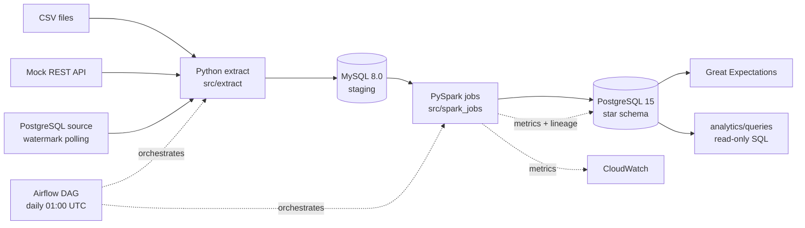
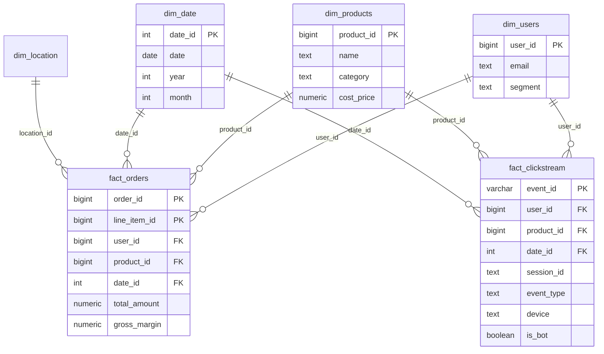

# E-Commerce Data Platform

## 1. Project summary

An end-to-end batch analytics pipeline that ingests e-commerce data from CSV files, a mock REST API and a PostgreSQL source (watermark-based incremental polling on `updated_at`, not log-based CDC), transforms it with PySpark into a PostgreSQL star schema, and orchestrates it daily through Airflow. Great Expectations suites are defined for data validation. It handles 210,263 order line items (100,000 orders), 500,000 clickstream events, 10,000 users and 2,000 products, about 710K records per full reload. The warehouse is defined in Terraform for AWS, and the local stack runs as Docker Compose with fakecloud emulating AWS. The Terraform AWS provider is currently configured for that local emulator (`localhost:4566`, dummy credentials), so deploying to real AWS needs that changed first (see the runbook). The integration suite runs against real PostgreSQL and MySQL containers: 23 tests, 22 passing and one skipped for an environment reason (Great Expectations does not import on the Python 3.12 venv), as recorded in the last full run.

## 2. Architecture



A fuller data-flow description is in [`docs/architecture/data_flow_diagram.md`](docs/architecture/data_flow_diagram.md).

## 3. Tech stack

| Layer | Tool | Version |
|---|---|---|
| Staging | MySQL | 8.0 |
| Warehouse | PostgreSQL | 15 |
| Transformation | PySpark | 3.5.0 |
| Orchestration | Apache Airflow | 2.8.0 |
| Data quality | Great Expectations | 0.18.15 |
| Infrastructure as code | Terraform | >= 1.9.0 |
| CI/CD | GitHub Actions (OIDC to AWS) | n/a |
| Database driver | psycopg (psycopg3) | 3.3.6 |
| Logging | python-json-logger, watchtower, colorlog | 2.0.7, 3.0.1, 6.8.2 |
| Testing | pytest, pytest-timeout, pytest-cov | 8.0.0, 2.2.0, 4.1.0 |
| Local AWS emulation | fakecloud | latest (`docker/fakecloud`) |
| Containers | Docker Compose | 9 services locally |

## 4. Key engineering decisions

**4.1 MySQL for staging, PostgreSQL for the warehouse.** Staging is a landing zone that takes row-by-row inserts from many sources and tracks per-batch state (`is_processed`, `batch_id`, watermarks). The warehouse serves analytical scans and joins. Splitting them means each engine does the job it is good at. *Alternative:* one PostgreSQL database for both. That is simpler, but it puts ingest writes and BI reads on the same engine and mixes raw and modelled data in one schema. The split also makes the staging engine swappable without touching the warehouse.

**4.2 PySpark over pandas.** The clickstream table has 500,000 events, and the sessionization step needs window functions over sessions. Spark runs those as distributed plans on a cluster and scales past one machine's memory. *Alternative:* pandas is faster to write and fine at this size on one machine. The cost of Spark here is startup time (about 30 seconds per job even for a few hundred rows), so the choice pays off as volume grows, not at the current size.

**4.3 Star schema over one wide table.** Dimensions (`dim_users`, `dim_products`, `dim_date`) are shared by facts and by aggregates, so a change to a segment name happens once. Facts are additive (quantity, revenue), so aggregates can be recomputed from them. *Alternative:* one denormalised table per question. That is faster for a single dashboard, but every new question copies data, and corrections have to be applied in several places.

**4.4 Incremental watermarks over full reloads.** Each source has a watermark (`watermarks.last_extracted_at`), and ingestion reads only rows newer than it. That keeps daily cost and latency proportional to new data. The correctness detail mattered: a second-precision watermark re-read boundary rows, so the column is `datetime(6)` (Phase 8.2). *Alternative:* full reloads. They are simpler and self-correcting, but they cost more with every row added, and they rewrite data that did not change. *Trade-off:* polling on `updated_at` only sees the latest state of a row, so hard deletes and intermediate changes between two runs are missed, and it relies on the source keeping `updated_at` reliable. Log-based CDC (for example Debezium) would capture those cases.

**4.5 fakecloud for local AWS emulation.** The pipeline calls S3, Lambda and CloudWatch Logs, and developers need those on a laptop with no AWS account. fakecloud is what the project uses and it covers the calls the code makes. *Alternatives:* LocalStack (widely used, and its editions and licensing have changed over time, so check the current terms before relying on it) and calling AWS directly from a dev account (costs money and needs credentials on every laptop). The trade-off is that fakecloud is less widely known, so the team has to maintain its setup.

## 5. Getting started (local development)

Target: under 15 minutes on a machine with Docker running.

```bash
git clone https://github.com/navya1009/ecommerce-data-platform.git
cd ecommerce-data-platform

cp .env.example .env
# Edit .env: set POSTGRES_PASSWORD, MYSQL_ROOT_PASSWORD, MYSQL_PASSWORD (required by docker-compose)

docker compose up -d
docker compose ps                                  # wait until postgres, mysql and airflow are healthy (about 2 minutes)

# Generate sample data. NON-PRODUCTION ONLY. This creates about 100,000 orders and can take several minutes.
docker exec ecommerce_pipeline python scripts/generate_fake_data.py

# Ingest the CSV files
docker exec ecommerce_pipeline python src/extract/ingest_csv.py

# Transform orders with Spark (same command the DAG runs)
docker exec ecommerce_pipeline spark-submit \
  --master spark://spark-master:7077 --deploy-mode client \
  --driver-memory 2g --executor-memory 2g --executor-cores 2 \
  --conf "spark.driver.extraClassPath=/opt/spark/jars/*" \
  --conf "spark.executor.extraClassPath=/opt/spark/jars/*" \
  --conf "spark.serializer=org.apache.spark.serializer.JavaSerializer" \
  --jars "/opt/spark/jars/mysql-connector-java-8.0.33.jar,/opt/spark/jars/postgresql-42.6.0.jar" \
  /app/src/spark_jobs/transform_orders.py --batch-id local_001 --env dev
```

Then open **http://localhost:8080** (Airflow; default login `admin` / `admin` unless you changed `AIRFLOW_ADMIN_PASSWORD`), turn on `ecommerce_daily_pipeline` and trigger it.

> **Timing note.** The setup steps are quick. The data generator and the first Spark run are the slow parts, and their time depends on your machine. The 15-minute target assumes images are already pulled. On a first run, image downloads add time.

## 6. Running the tests

```bash
make test-unit          # fast tests, no Docker, no AWS (52 passed, 18 skipped)
make test-integration   # starts isolated Postgres (5433) and MySQL (3307) containers
make test-all           # both
make coverage           # unit tests with an HTML report in htmlcov/
```

The integration suite never uses the dev ports (5432, 3306). Its containers are torn down at the end of each run.

**Known gap: unit-test coverage is about 43%** (measured; an earlier version of this README said 19%), against the 80% threshold the CI workflow enforces, so the coverage step fails as configured. All 18 skipped unit tests are stubs for functions that do not exist yet, including the whole Spark transform test group, so the Spark transforms have no unit tests. They are exercised only by the integration suite, and coverage tooling does not measure that. Raising coverage is deferred.

## 7. Deploying to AWS

Follow [`deployment/RUNBOOK.md`](deployment/RUNBOOK.md). It covers the Terraform state backend, provisioning, database migrations, Airflow connections, the first run, verification, and rollback. The runbook lists the known blockers before a production deployment.

**Status:** the pipeline has been run on the local Docker Compose stack only. The Terraform AWS provider is configured for the local emulator, so it has to be pointed at a real account (with real credentials) before the Terraform can provision anything.

## 8. Data model



`fact_clickstream.event_id` is a `VARCHAR` holding the source event id. Migration 007 changed it from `BIGSERIAL`, because the source ids are not numeric. `fact_orders` is keyed on `(order_id, line_item_id)`. Bot-flagged clickstream events are stored with `is_bot = TRUE`, and the analytics queries exclude them.

## 9. Pipeline metrics

| Metric | Value | Source |
|---|---|---|
| Full pipeline runtime | 2 min 11 s | Phase 5 measurement on the development stack |
| Orders ETL runtime | 39 s for 210K line items | Phase 3 measurement |
| Clickstream ETL runtime | not yet measured at 500K events (34.8 s was measured for 499 events, mostly Spark startup) | Phase 10.1 extension |
| Daily DAG schedule | 01:00 UTC (`0 1 * * *`) | `dags/airflow_config.py` |
| Retry policy | 3 retries, exponential backoff from 5 to 30 minutes | DAG default args |
| Enforced SLA | 30 minutes, on the API ingest task only | DAG task config |
| Order line items | 210,263 | development database |
| Clickstream events | 500,000 | development database |
| Data freshness target | under 60 minutes | **target, not enforced by code yet** |
| Quarantine rate target | under 0.5% | **target, not enforced by code yet** |

The 210,263 and 500,000 figures are dataset sizes loaded in development, not measured daily volumes. Each job writes a row to `warehouse.pipeline_metrics` and lineage edges to `warehouse.pipeline_lineage`. The CloudWatch dashboard definition is in `monitoring/`.

## 10. Folder structure

```
├── analytics/queries/     # Read-only BI queries: revenue, funnel, inventory, customer
├── dags/                  # Airflow DAG definition and callbacks (tasks/self_healing.py is written but not wired in)
├── data/                  # Raw and processed CSV files (not yet listed in .gitignore)
├── deployment/            # Production runbook
├── docker/                # One Dockerfile directory per service: airflow, api, fakecloud, mysql, postgres, spark
├── docker-compose.yml     # Local stack (9 services)
├── docs/                  # api/ (endpoints), architecture/ (data flow), setup/ (local setup)
├── great_expectations/    # GE suites, checkpoints and plugins
├── lambda/                # S3-to-Airflow trigger functions
├── migrations/            # Ordered SQL: postgres/ (warehouse), mysql/ (staging)
├── monitoring/            # CloudWatch dashboard JSON and deploy notes
├── scripts/               # Bootstrap, data generation, Airflow connection setup
├── src/
│   ├── api/               # FastAPI mock server
│   ├── extract/           # Ingestion: CSV, API, PostgreSQL watermark polling (ingest_kafka.py exists but no DAG task calls it)
│   ├── spark_jobs/        # PySpark transforms: orders, clickstream, aggregates
│   ├── transform/         # Empty placeholder files; not used by the DAG
│   └── utils/             # Logging, metrics, lineage, warehouse connection helpers
├── terraform/             # Terraform root and modules with prod and dev environments (AWS provider currently set to the local emulator)
└── tests/
    ├── unit/              # Fast tests, no external services
    └── integration/       # Real Postgres and MySQL containers, end-to-end jobs
```

## 11. Known limitations

- **Kafka is not part of the DAG.** The consumer script exists, but no Airflow task calls it, so clickstream data currently arrives through CSV ingestion.
- **Self-healing is not wired in.** `dags/tasks/self_healing.py` is not imported anywhere. Failure recovery today is Airflow retries only.
- **Missing manifest script.** The DAG's manifest step calls `scripts/update_pipeline_manifest.py`, which does not exist yet.
- **Empty placeholder files.** `api_extractor.py`, `postgres_cdc.py`, `kafka_consumer.py`, the `load/` and `transform/` modules, and `dags/extract_dag.py`, `dags/transform_dag.py` and `dags/load_dag.py` contain no code. The working logic lives in the files listed in the architecture diagram.
- **Hardcoded credentials.** `great_expectations.yml`, `docker-compose.yml` and the `scripts/fix_*.py` helpers contain credentials, which the `.env` setup in section 5 does not cover. The "no hardcoded credentials" unit test scans only `src/`. These are development defaults and must be replaced before any real deployment.
- **Great Expectations coverage.** The GE integration test is skipped on the Python 3.12 venv, so the checkpoint is not exercised by the integration suite.
- **Integration results.** The 22 passing and 1 skipped figure is from the last full run and was not re-run in the most recent review.
- **Unenforced targets.** The freshness and quarantine-rate targets in section 9 are goals, not checks.

## 12. Acknowledgements

Acknowledgements: built with Apache Airflow, Apache Spark, Great Expectations, Terraform, pytest and fakecloud.